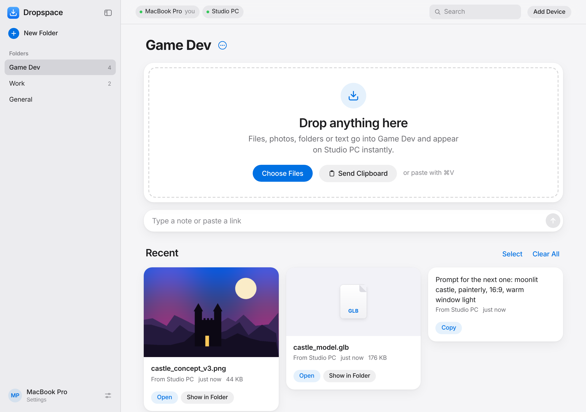
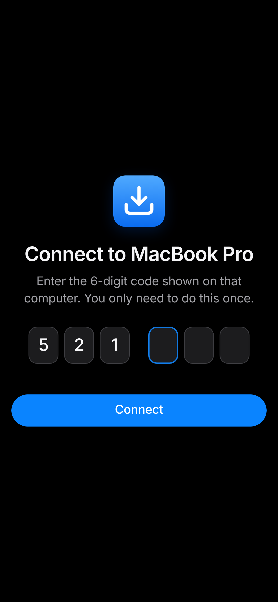

# Dropspace

**Drag something onto one computer. It shows up on the other.**

Made by Abdur Rahman Ansar.

Dropspace is a shared drop box for your computers on the same Wi-Fi. Drop something in on one computer and it shows up on the other one instantly, already saved where you want it. Images, files, whole folders, text, links, whatever. No accounts, no cloud, and no more emailing things to yourself like it's 2009.



## Why I built it

I make games as a hobby. My game is on my main computer, and on another computer I generate art and make 3D models. So whenever I had to send my main computer the 3D files, or a specific prompt to give Claude Code to do some debugging or whatnot, it would usually take me 5 unnecessarily long steps. I would first download it on the other computer, then open Gmail, send it to myself, wait sooo loong because it sends the file over the World Wide Web (really wide), then I'd receive it, download it again, and then finally import it into my game's assets folder. I know, it looks long even while reading. That's why I made it.

With Dropspace it's 1 single step. I drag the image or whatever it is into the browser window on the other computer (I don't even have to drag, I can just copy paste it in), and it lands directly in my game's assets folder on my main computer.

## What it does

The main thing is the box in the middle. Drag stuff onto it (or paste with ⌘V) and it pops up on your other devices right away. Everything gets saved to a folder on the Mac running Dropspace, so you never have to download anything twice.

Other things it can do:

- Folders for different projects, in a sidebar like a chat app. Hide it with ⌘\ when you want more room
- Right-click files in Finder → Quick Actions → Send to Dropspace. No browser needed
- ⌃⌥⌘V sends whatever you copied, from any app. Yes, that's four keys. It's worth it
- Share photos from your iPhone's Share button without even opening the page
- Select a bunch of things and download them as one zip, or delete them all at once
- Search every folder, for when you have 40 files called `final_v2_actually_final.png`
- Click an image to preview it, and use the arrow keys to flip through
- Point a folder at your game's Assets folder and files land right in the project
- Light and dark mode (you already know which one I use)
- On a Mac it's always at `http://dropspace.local`, so you can bookmark it and forget about it
- Starts by itself when you log in. No Terminal window sitting there judging you
- Phones pair by scanning a QR code
- Zero npm packages. Just Node.js

The other computer doesn't install anything. Any browser works: Mac, Windows, Chromebook, iPhone, Android. Probably even that one old laptop.

## Setting it up

You need [Node.js](https://nodejs.org) 18 or newer on the Mac that runs Dropspace (the LTS installer is fine). Every other device just needs a browser.

### On your main Mac

1. Download this repo (green Code button → Download ZIP) and unzip it.
2. Double-click `Install Dropspace.command`.
   macOS will probably block it the first time, because it didn't come from the App Store and Apple doesn't know me personally. Go to System Settings → Privacy & Security, scroll down, click Open Anyway, then Open.
3. If it asks whether `node` can accept incoming connections or get into your Downloads folder, click Allow. If you see "Background Items Added", don't panic. That's just Dropspace setting itself up to start when you log in.
4. Dropspace opens in your browser with a 6-digit code.

That's it. From now on it runs in the background and you never have to start it again. There's a Dropspace app in Applications you can drag into your Dock. To update, download the new version and run the installer again. To uninstall (why though), run `extras/Uninstall Dropspace.command`. Your files stay where they are.

### On your other computer or phone

Get on the same Wi-Fi, open `http://dropspace.local`, and type the code. It stays paired after that.

Make sure you type the address in the address bar at the top, not into Google. Ask me how I know.

For a phone, it's easier to click Add Device on the Mac and scan the QR code with the camera. No typing at all.



### If your other computer is also a Mac

Run the installer on it too. Don't worry, it won't install a second Dropspace. It notices Dropspace is already running on your main Mac, asks for the code once, and then:

- adds Send to Dropspace to Finder's right-click menu
- makes ⌃⌥⌘V send your clipboard to the main Mac
- sets up a secure (https) connection. It asks for your Mac password once for this, which is normal, I promise

If Send to Dropspace doesn't show up in the right-click menu, log out and back in. Classic Mac. Anything you send this way goes into whatever folder you have open in Dropspace on that Mac.

You can also send from Terminal, if you're that kind of person: `node send.js photo.png`, `node send.js --clipboard`, or `node send.js --to "Game Dev" photo.png`.

### Don't want to install anything?

Double-click `Start Dropspace.command` on a Mac or `Start Dropspace (Windows).bat` on Windows, or run `npm start`. You have to keep that window open the whole time though, so honestly, just install it.

## Sending from your iPhone

1. Open Dropspace on your iPhone (scan the QR code the first time).
2. Tap Settings (the little sliders icon at the bottom of the folder list), then Set Up Share Button.
3. Tap Add Shortcut, then Add Shortcut again in the Shortcuts app. If that button isn't there, the steps under it walk you through making the shortcut yourself. It takes a couple of minutes.

Now in Photos or Files, tap Share → Send to Dropspace. Tap Allow the first time. If you don't see it, scroll all the way down the share sheet and tap Edit Actions to add it.

Whatever you share lands in the folder you have open on the Mac. You can see and remove phones in Settings on the Mac.

## Sending straight into a game project

This is literally why Dropspace exists. Make a folder (like "Game Dev"), click the ⋯ next to its name, and change "Save to" to your project's assets folder, like `~/Projects/MyGame/Assets/Incoming`. Now anything you drop into that folder, from any device, lands right in your game. Unity and Godot pick up new files on their own, so you don't even have to import them. Your other folders still save to `~/Downloads/Dropspace`.

## Options

For the people who like to start things themselves with `node server.js`:

| Option | What it does |
| --- | --- |
| `--folder <path>`, `-f` | Where files get saved (default `~/Downloads/Dropspace`) |
| `--name <name>`, `-n` | The name other devices see for this computer |
| `--port <number>`, `-p` | Which port to use (default is 80 on a Mac if it's free, otherwise 8765) |
| `--no-open` | Don't open the browser when it starts |
| `--no-https` | Turn off the https address |

## How it works (the nerdy part)

The Mac runs a small Node.js server (`server.js`) with zero npm packages. Your other devices open it in a browser. Uploads stream straight to disk, so even a huge video is fine, and the server pushes new stuff to every open browser with [Server-Sent Events](https://developer.mozilla.org/en-US/docs/Web/API/Server-sent_events). That's why things show up instantly instead of you hitting refresh like a maniac.

```
  Other computer (any browser)                    Host computer (runs server.js)
 ┌──────────────────────────────┐   your Wi-Fi   ┌─────────────────────────────────┐
 │ drop a file ─────────────────┼── HTTP upload ─▶ streams it into the folder       │
 │                              │                │                                 │
 │ board updates ◀──────────────┼─ live events ──┤ tells every connected device    │
 └──────────────────────────────┘    (SSE)       └─────────────────────────────────┘
```

Some details, if you're curious:

- `dropspace.local` is announced on your network with the Mac's built-in Bonjour tool (`dns-sd`). That's the same thing AirDrop uses to find devices.
- The installer copies everything to `~/Library/Application Support/Dropspace` and adds a LaunchAgent, so it starts at login and restarts itself if it ever crashes. Logs are in `~/Library/Logs/Dropspace.log`.
- Your folders and everything on the board are saved in `~/.dropspace`, so nothing disappears when it restarts.
- Send to Dropspace and ⌃⌥⌘V are Automator Quick Actions that run `send.js`. `clipboard.js` reads the clipboard using the Mac's own tools (`osascript`, `pbpaste`, `sips`).
- For https, `tls.js` makes Dropspace its own little certificate authority and a certificate for `dropspace.local`, using only Node's `crypto`. It renews the certificate by itself.
- `zip.js` builds zips on the fly without recompressing anything, and switches to ZIP64 if a zip goes over 4 GB.
- The iPhone shortcut (`shortcut.js`) sends each shared file to `/api/share` with a key only that phone has. On a Mac, Dropspace signs the shortcut with the built-in `shortcuts` tool so you can add it in one tap.

## Security

I know, a whole security section for an app that sends PNGs. But they're my files, so:

- Other devices need the 6-digit code once. Wrong guesses are limited to 5 every 5 minutes, so nobody's guessing their way in. Forget All Devices in Settings kicks everyone out and makes a new code.
- QR codes use a one-time token that expires in 10 minutes, not the actual code.
- Random websites can't send requests to it (it checks a custom header and the origin), and it only answers to local network addresses, which blocks [DNS rebinding](https://en.wikipedia.org/wiki/DNS_rebinding).
- Sneaky file names like `../../something` get cleaned up, so nothing can be saved outside the folder. Nothing gets overwritten either. You get `name (1).png` instead.
- Files you receive can't run scripts in your browser. They're served sandboxed, and `.html` files always download instead of opening.
- With the secure connection on, everything between your Macs is encrypted, and the other Mac only trusts your main Mac's certificate.
- The Dropspace certificate authority uses X.509 name constraints, so it only works for local names like `.local` and private IPs. Even if someone stole it, they couldn't use it to fake a real website.
- There's a "Secure connections only" switch in Settings for when you're on Wi-Fi you don't trust, like at school.
- Each phone's Share button has its own key. The Mac only stores a hash of it, and a key can only add things, nothing else.

Being honest about the limits: devices that aren't set up for https (like a phone without the profile) still use plain http unless you turn on "Secure connections only". Also, the certificate gets copied over the network when you set up another Mac, so do that at home, not at Starbucks.

## If something's not working

**The other computer can't open the address.** Make sure both are on the same Wi-Fi, and not a guest network. School and office Wi-Fi often stops devices from seeing each other. Some older Windows PCs and Android phones can't open `.local` addresses, so use the number address under "Address not working?" in Add Device. Also check the Mac's firewall (System Settings → Network → Firewall) lets `node` through.

**"The host computer didn't let Dropspace save…"** macOS asks before apps save to Downloads, Documents or Desktop. Go to System Settings → Privacy & Security → Files and Folders and turn it on for `node`.

**Send to Dropspace isn't in the right-click menu.** Log out and back in. If it's still not there, check System Settings → Keyboard → Keyboard Shortcuts → Services. You can change the ⌃⌥⌘V shortcut there too, if four keys is too many for you.

**The Dropspace app says it didn't start.** Run the installer again. The log is at `~/Library/Logs/Dropspace.log` if you want to see what went wrong.

**"Too many wrong codes".** Wait 5 minutes and try again. That's the punishment for guessing.

**Copy or Send Clipboard doesn't work on the other computer.** Browsers block clipboard access on plain http pages. Run the installer on that Mac to set up https, or just copy things the old-fashioned way.

**The other Mac doesn't switch to https.** Run the installer again and click Continue at the password step. Safari and Chrome are fine, but Firefox uses its own certificate list, so it might stay on http.

**The iPhone says it can't connect.** The phone has to be on the same Wi-Fi, and you need to tap Allow the first time. If "Secure connections only" is on, the phone also needs the profile from Settings → Secure Connection.

## Development

```sh
npm test     # runs all 37 tests (they pass, I checked)
npm start
```

```
server.js            the server: uploads, live updates, pairing
public/              the web page (index.html, style.css, app.js, theme.js)
public/vendor/       QR code generator (MIT, Kazuhiko Arase)
send.js              sends files or the clipboard (used by the right-click menu and ⌃⌥⌘V)
clipboard.js         reads the Mac clipboard
tls.js               certificates for the https connection
zip.js               builds zips for downloading a bunch of things at once
multipart.js         reads uploads from the iPhone shortcut
shortcut.js          makes the iPhone shortcut
Install Dropspace.command   the Mac installer
mac/                 the app icon
extras/              the uninstaller
test/                tests (Node's built-in test runner)
```

## Ideas for later

- A menu bar icon that tells you when something arrives
- Automatically send anything saved into a chosen folder

Got a better idea? Open an issue.

## Similar tools

I didn't invent sending files, I know. AirDrop (Apple only), [LocalSend](https://localsend.org) and [PairDrop](https://pairdrop.net) do similar things. The difference is that Dropspace is a shared board with folders, not one-off sends, and files land exactly where you want them instead of piling up in Downloads with the other 900 things in there.

## License

MIT © 2026 Abdur Rahman Ansar. See [LICENSE](LICENSE). Basically: use it, change it, share it, just keep my name on it.

If you actually read this whole thing, thank you. Genuinely.

Peace ✌️\
-Abdur :]
